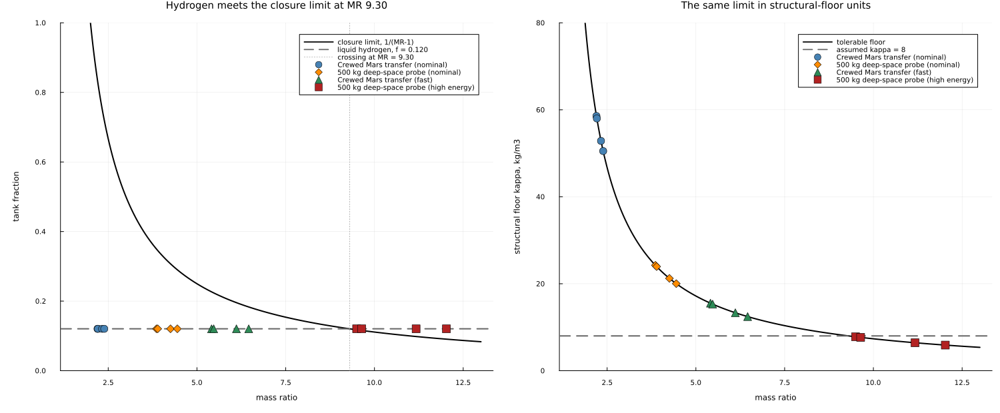
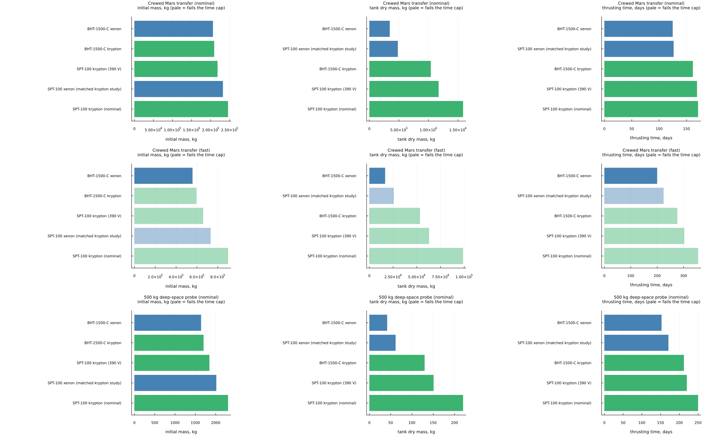

# skidbladnir

Quantitative comparison of candidate space propulsion systems for two reference missions:
a crewed Mars transfer and a 500 kg deep-space probe.

Start with `docs/survey.md` for the cited literature review and `docs/findings.md` for the
results and what they rest on.

## Layout

    docs/survey.md      literature survey, cited, with open problems per propulsion class
    docs/findings.md    results, ranked candidates, remaining unknowns
    docs/figures/       plots produced by the Julia pipeline
    sql/schema.sql      DuckDB schema, constraints, views and COPY loaders
    data/raw/*.csv      raw inputs, version controlled
    data/propulsion.duckdb   built artifact, not version controlled
    scala/              Mill module: typed dataset, SQL validation, comparison pipeline
    julia/Propulsion/   numerical models, plots, unit tests
    lean/               Lean 4 and Mathlib formalisation of the relations used
    scripts/            pipeline and sensitivity entry points

## Figures

Produced by `scripts/run_julia_pipeline.jl` from the results table, and regenerated
whenever the model changes.

### Why nuclear thermal is the most assumption-sensitive case

A vehicle closes only while its tank fraction stays below `1/(MR - 1)`, so the tolerable
fraction collapses as delta-v rises. Liquid hydrogen's fraction is pinned near 0.120 by its
storage density, which leaves the mission's mass ratio to decide whether a nuclear thermal
vehicle exists at all. The two lines cross at a mass ratio of 9.30: every engine to the left
closes, every engine to the right does not. The high-energy probe sits just past the
crossing, which is why its nuclear thermal rows are infeasible — a chosen constant landing
on the wrong side of a threshold rather than a physical conclusion. The right panel says the
same thing in the structural-floor units the sensitivity sweep varies, against the 8 kg/m3
the comparison assumes.

### Krypton against xenon on matched hardware

Three measured krypton operating points against the xenon they are set against, over three
missions, with rows that fail their time cap drawn pale. Xenon is lighter in every initial
mass panel on the left, krypton's tank is about three times larger in every tank panel in the
middle, and krypton is slower in every time panel on the right. The middle column is the
mechanism: krypton genuinely carries less propellant, and its tank more than consumes the
saving. Without a tank model krypton won all four pairings, which is what `docs/findings.md`
had reported before tankage was charged.

### The rest

    initial_mass.png       best candidates per mission, coloured by thruster type
    propellant_mass.png    the same ranking on propellant mass
    trip_time.png          the same on thrusting time; nuclear thermal is absent by
                           construction, since the power-limited model does not evaluate it
    isp_vs_trip_time.png   the central trade, specific impulse against thrusting time

## Languages

Julia for numerical models and plotting. Scala 3 with Mill for ingestion, validation and the
comparison pipeline. Lean 4 with Mathlib for the formal statements and proofs. DuckDB for all
storage, reached from Scala over JDBC and from Julia via DuckDB.jl. No Python.

Dependencies outside the standard libraries are DuckDB.jl, DataFrames.jl, Plots.jl, the
DuckDB JDBC driver and Mathlib.

## Running everything

    # 1. build the database from the CSVs
    duckdb data/propulsion.duckdb < sql/schema.sql

    # 2. Scala: validate and run the comparison
    cd scala
    mill pipeline.runMain propulsion.Verify          # assertion-based self-tests
    mill pipeline.runMain propulsion.Main validate   # SQL range and consistency checks
    mill pipeline.runMain propulsion.Main compare    # writes producer 'scala'
    mill pipeline.runMain propulsion.Main report     # ranked table
    cd ..

    # 3. Julia: models, metrics and figures
    julia --project=julia/Propulsion julia/Propulsion/test/runtests.jl
    julia --project=julia/Propulsion scripts/run_julia_pipeline.jl   # writes producer 'julia'
    julia --project=julia/Propulsion scripts/sensitivity.jl

    # 4. Lean: build the proofs and confirm no sorry
    cd lean
    lake build
    lake env lean check_axioms.lean
    cd ..

The database path is found by walking up from the working directory, so the Scala and Julia
entry points work from anywhere in the tree. Set `PROPULSION_DB` to override.

## How the three implementations relate

The same relations are implemented three times on purpose. Scala and Julia implement them
independently, and the Julia test suite joins both producers' rows in the `results` table and
requires agreement to 1e-9 relative, so a mistake in one shows up as a disagreement rather
than as a plausible wrong answer. Lean states and proves the relations, including the
mass-fraction bound the comparison depends on. Each Scala and Julia function names the Lean
declaration it corresponds to.
